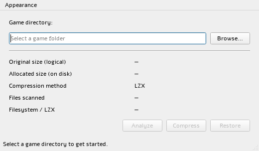
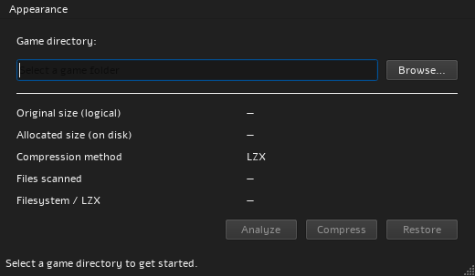

# Compresso

Compresso is a Windows desktop utility for analyzing game folders and applying Windows' native, transparent NTFS LZX compression to eligible files in place. The game files keep their names and paths, and Windows decompresses data as applications read it. Compresso does not create game archives, and it does not contain a custom LZX encoder.

## Screenshots

These screenshots show the real Compresso main window in its light and dark themes. The fields are empty because no sample game data is included.

| Light theme | Dark theme |
|:--:|:--:|
|  |  |

## Features

- Select an existing game directory with the Windows folder picker or enter its path.
- Analyze file count, total logical size, current allocated disk size, filesystem type, and LZX eligibility.
- Compress eligible files one at a time with Windows `compact.exe /C /EXE:LZX`.
- Restore supported LZX-compressed files with Windows `compact.exe /U /EXE:LZX`, after confirmation.
- Run scans and file operations in a background worker. See completed-file progress, current filename when available, elapsed time, and status. Cancel stops new files from being scheduled; completed changes remain in place.
- Compare measured allocated usage before and after compression. The result can show no savings or increased allocation; it is not an estimate based on file types.
- Choose System, Light, or Dark appearance. Compresso remembers the theme, last validated directory, and window geometry. It never resumes a compression or restore operation on launch.
- Review operation diagnostics, including skipped and failed files, through **Details** when diagnostic entries are available.

## How LZX compression works

Compresso asks Windows `compact.exe` to apply the Windows Overlay Filter (WOF) LZX file-compression provider to supported files. Windows stores each compressed file at its existing path and presents its original logical contents to software that opens it. A game can continue to access the files directly; there is no container file to mount, unpack, or teach a launcher to read.

This differs from ZIP and 7z archives. An archive packages files into a separate container, and applications generally need an extraction or archive-aware loading step before using the original file tree. Compresso does neither: compression state belongs to the Windows filesystem, and game files stay in place.

Compresso invokes the Windows utility with safely separated process arguments. It does not parse localized console text to infer per-file progress or success. File outcomes, process exit codes, captured output, and post-operation checks are used to report results. **Compresso does not implement an LZX encoder and does not create ZIP, CAB, 7z, or other game archives.** The portable ZIP described below distributes Compresso itself; it is unrelated to game compression.

## System requirements

### To run the portable application

- 64-bit Windows 10 or later.
- No separate Qt installation is needed for the portable Release package; it contains the Qt libraries, plugins, and required MinGW runtime libraries.
- Administrator privileges are not normally needed to open the application or work with a game folder the current Windows account can access. Compresso does not silently elevate. Windows permissions can prevent access to protected or restricted files.

### To analyze or change game-file compression

- The selected game folder must be on a local, fixed NTFS volume that reports support for file compression.
- FAT, exFAT, ReFS, network paths, removable volumes, and other volumes that do not meet that check are not eligible for LZX operations. Analyze still reports the filesystem and eligibility result.
- Windows' `compact.exe` and WOF services must be available.

### To build from source

- Windows 10 or later, 64-bit.
- CMake 3.25 or later and Ninja.
- GCC/MinGW-w64 with C++23 support.
- Qt 6.4 or later, Widgets and Test modules, built for the same MinGW toolchain/ABI as GCC.

The supported CI toolchain uses MSYS2 UCRT64 packages: MinGW-w64 GCC, CMake, Ninja, and `mingw-w64-ucrt-x86_64-qt6-base`. The last package supplies Qt 6 Widgets and Test. Use the UCRT64 terminal so the matching compiler and Qt tools are on `PATH`.

## Build and test

Install the toolchain from an MSYS2 UCRT64 terminal:

```bash
pacman -S --needed mingw-w64-ucrt-x86_64-gcc mingw-w64-ucrt-x86_64-cmake mingw-w64-ucrt-x86_64-ninja mingw-w64-ucrt-x86_64-qt6-base
```

Configure, build, and run the tests with the Debug preset:

```bash
cmake --preset debug "-DCMAKE_PREFIX_PATH=$(cygpath -m /ucrt64)"
cmake --build --preset debug
ctest --test-dir out/build/debug --output-on-failure
```

For an optimized Release build and portable distribution:

```bash
cmake --preset release "-DCMAKE_PREFIX_PATH=$(cygpath -m /ucrt64)"
cmake --build --preset release
ctest --test-dir out/build/release --output-on-failure
cmake --build --preset release --target package-portable
```

The package target installs the executable, Qt deployment files, and required runtime DLLs to `out/build/release/portable/Compresso/`, then creates `Compresso-0.1.0-windows-x64.zip` in the `portable/` directory. Extract the ZIP and run `Compresso/bin/Compresso.exe`. For an unpackaged Debug build, run `out/build/debug/Compresso.exe` from the UCRT64 terminal so Qt and MinGW runtime DLLs are on `PATH`.

GitHub Actions builds and tests Debug and Release on Windows. Its Release job also packages the portable ZIP, launches the extracted application with Qt and MSYS2 removed from `PATH`, and uploads the ZIP as a workflow artifact.

## Use Compresso

1. Start Compresso and choose the game installation folder with **Browse…**, or type an existing path and press Enter. Selecting a directory does not start a scan or compression.
2. Select **Analyze**. The window reports logical file size separately from currently allocated disk size, along with file count, filesystem, and whether the volume is eligible for LZX. Scanning does not modify game files.
3. If the selected directory is eligible, choose **Compress** to start the in-place operation. Check the status summary for compressed, skipped, and failed counts and actual allocated-space change. Use **Cancel** to stop scheduling additional files; changes already completed are not rolled back.
4. Use **Details** when shown to inspect paths and diagnostics for skipped or failed items.

## Restore compressed files safely

Restore reverses Compresso's transparent LZX file-compression state. It does not extract an archive or make replacement copies.

1. Select and analyze the same game installation folder. Confirm that the path is the intended installation before proceeding.
2. Choose **Restore** and read the confirmation. Choose **Yes** only if you want Compresso to remove supported LZX compression from files under that selected folder.
3. Let the operation finish, then review its restored, skipped, and failed counts. **Details** contains per-file information when issues were reported. If cancelled, already restored files stay restored and the active file's final state may be unverified.
4. Check that the game and its launcher work as expected. Restoration can be run again for remaining supported LZX files.

Compresso restores only files Windows identifies as using the individual-file WOF LZX provider. It skips files using other compression methods, files whose WOF state cannot be verified, and files with multiple hard links. It checks the file contents before and after restoration and reports a failure if the verified bytes differ. Paths are preserved.

## Limitations and compatibility

- **NTFS eligibility:** Only local fixed NTFS volumes that advertise file-compression support are eligible. Compresso does not fall back to ordinary NTFS compression or another format.
- **Read-only and protected files:** Compresso does not clear read-only attributes, change ACLs, or request broad elevation. Windows may allow some read-only files or reject them depending on their permissions and state; inaccessible or busy files are reported as skipped or failed.
- **Not every file is a candidate:** Symbolic links, junctions, mount points, encrypted or sparse files, already-compressed files, and inaccessible or actively used files may be skipped. Compresso does not follow directory reparse points.
- **Game and launcher compatibility:** Transparent file access does not guarantee that every game, launcher, update process, mod tool, or anti-cheat system will accept compressed files. Compression can add CPU work when data is read and can affect loading or runtime performance. Test a game and its launcher after compression; restore its LZX files if it misbehaves.
- **Space savings vary:** Results depend on file contents and filesystem allocation. Some files compress poorly, save negligible space, or use more allocated space after compression. Compresso reports measured allocation before and after the operation; it does not predict savings from extensions or file attributes.
- **Partial operations:** Files are handled individually. A process-level failure stops further scheduling because Windows' localized output cannot reliably identify whether it is safe to continue. Cancellation does not undo completed files. Review the final status and Details before retrying.

For implementation details, see [filesystem scanning](docs/filesystem-scanning.md), [compression behavior](docs/compression.md), [the native backend](docs/compression-backend.md), [background operations](docs/async-operations.md), and [error reporting](docs/error-handling.md).

## License

Compresso is distributed under the MIT License. See [LICENSE](LICENSE).
